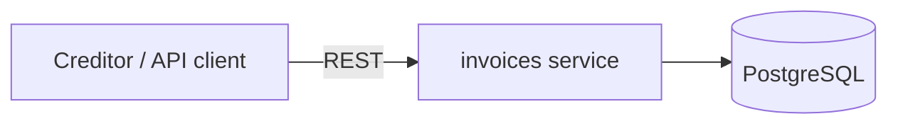

# Debt Collection Platform

[](https://github.com/victorbicego/debt-collection-platform/actions/workflows/ci.yml)
[](https://sonarcloud.io/summary/new_code?id=victorbicego_debt-collection-platform)
[](https://sonarcloud.io/summary/new_code?id=victorbicego_debt-collection-platform)

A simplified debt collection and payments platform, built as a learning project in backend architecture.
It is a single system that grows with each phase of my study plan — the companion notes and exercises live in
[backend-engineering-studies](https://github.com/victorbicego/backend-engineering-studies).

Generic domain and **fictitious data only**. No code or data from any employer.

## What the system does
Creditors register invoices owed by debtors. The platform reminds debtors, receives payments, negotiates payment plans,
and reconciles what reached the bank with what was owed.

## Architecture today

More in [docs/architecture](docs/architecture/overview.md). Decisions in [docs/adr](docs/adr).

**What to build:** the product is specified in [docs/product/requirements.md](docs/product/requirements.md) and broken into small items in [docs/backlog.md](docs/backlog.md).

## Roadmap
| Phase | What gets added | Topics | Status |
|-------|-----------------|--------|--------|
| 1 | Invoices service in Spring Boot 4 with Java 25, states modelled with sealed classes, PostgreSQL with indexes and optimistic locking, tests with Testcontainers and ArchUnit | 1–7 | 🟨 |
| 2 | Split into 3 services (invoices, payments, notifications), APIs with idempotency keys, Kafka with Outbox, payment Saga with compensation, Redis cache, Resilience4j on every remote call | 8–13 | ⬜ |
| 3 | Kubernetes with Helm, AWS infrastructure in Terraform, OpenTelemetry with dashboards and SLOs, CI/CD pipeline with canary, login with Keycloak/OIDC | 14–19 | ⬜ |
| 4 | Hexagonal architecture, context map and ADRs, C4 diagrams, a legacy module migrated with Strangler Fig | 20–24 | ⬜ |
| 5 | Professional README, public design docs, technical articles about the project's decisions | 25–28 | ⬜ |
| 6 | Multi-tenant platform with creditors as tenants, financial core with ledger, reconciliation and payouts, AI module for operators with evals and cost control | 29–32 | ⬜ |

## Running locally
Requires Java 25 and Docker. Maven is not needed: each service has a wrapper.

```bash
docker compose -f platform/docker-compose.yml up -d
cd services/invoices
./mvnw spring-boot:run
```

Try it with [`services/invoices/http/invoices.http`](services/invoices/http/invoices.http) (IntelliJ HTTP client) or curl:

```bash
curl -i -X POST localhost:8080/invoices -H 'Content-Type: application/json' \
  -d '{"debtor":"Jane Example","amount":150.00,"currency":"EUR"}'
```

Tests start their own PostgreSQL with Testcontainers; only Docker is needed:
```bash
cd services/invoices && ./mvnw verify
```

## Repository layout
```
docs/
  product/       what the platform does (requirements, business rules)
  backlog.md     what to build next, phase by phase
  adr/           architecture decision records
  architecture/  C4 diagrams and ubiquitous language
  design/        design docs, written before big features
  runbooks/      how to diagnose and fix known problems
services/
  invoices/      Spring Boot service (payments and notifications come in phase 2)
platform/
  docker-compose.yml   local infrastructure (helm/ and terraform/ come in phase 3)
```

## Contributing
This is a personal learning project, but the workflow follows team practice: small commits in
[Conventional Commits](https://www.conventionalcommits.org) style, CI green before merging, and an ADR for every decision that is hard to reverse.
