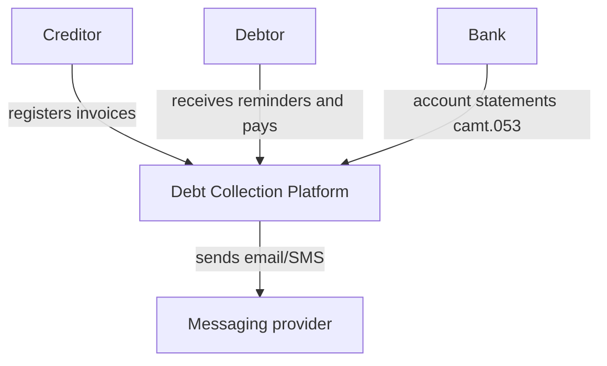
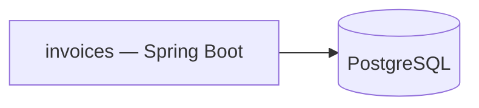

# Architecture overview

## System context (C4 level 1)

## Containers (C4 level 2)
Update this diagram whenever a service is added.

## Ubiquitous language
| Term | Meaning |
|------|---------|
| Creditor | Company that is owed money and hands the case over for collection |
| Debtor | Person or company that owes money |
| Invoice | An amount owed by a debtor to a creditor, with a due date |
| Payment plan | Instalments negotiated for one or more invoices |
| Reconciliation | Matching money received at the bank with what was expected |
