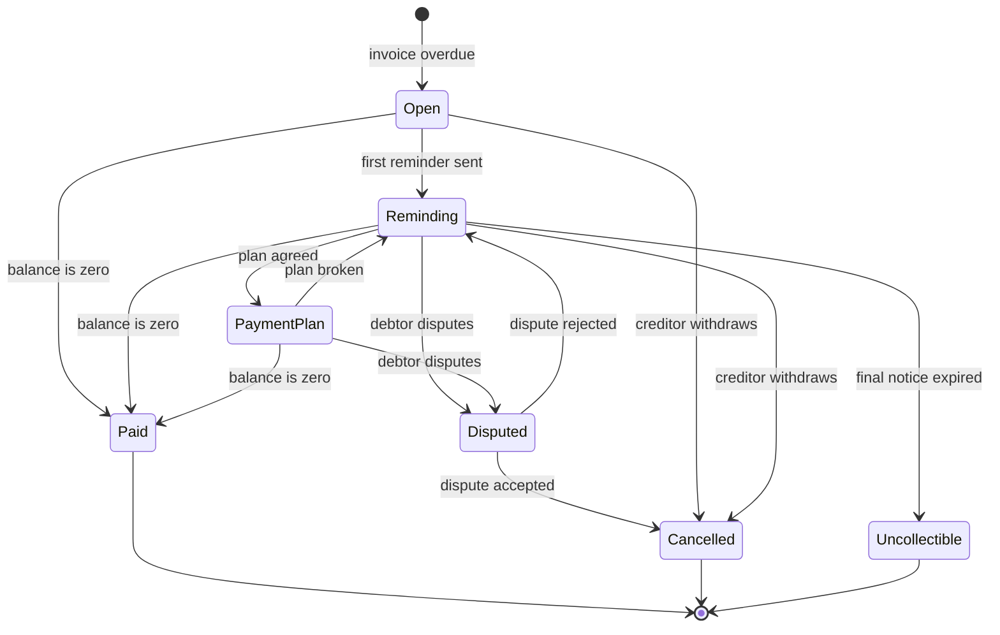

# Product requirements

What the platform does, independent of technology. Technical choices are made topic by topic and recorded as ADRs in [docs/adr](../adr).
The work is broken down in [docs/backlog.md](../backlog.md).

The domain is generic and every name, amount and person in this repository is fictitious.

## 1. Purpose
Companies (creditors) hand over unpaid invoices. The platform contacts the debtors, collects the money with fees and interest,
offers payment plans, reconciles incoming bank payments and pays the collected amounts out to the creditors.

## 2. Actors
| Actor | What they do |
|-------|--------------|
| Creditor | Registers invoices, follows its cases, receives payouts and reports. Calls the API. |
| Debtor | Receives reminders, pays, asks for a payment plan, disputes a claim. |
| Collection agent | Internal operator. Handles disputes, unmatched payments and special cases. |
| Administrator | Configures creditors, fee schedules and contact rules. |
| System | Scheduled jobs: due-date checks, reminders, interest, reconciliation, payouts. |

## 3. Core concepts
| Concept | Description |
|---------|-------------|
| Creditor | Company owed money. Has its own configuration: fee schedule, interest rate, contact strategy, commission. |
| Debtor | Person or company that owes money. Has contact data (email, phone, postal address) and a preferred language. |
| Invoice | Amount owed by one debtor to one creditor, with an invoice number, issue date, due date and currency. |
| Collection case | Opened when an invoice becomes overdue. Groups the invoices of one debtor for one creditor and carries the balance, fees, interest and history. |
| Payment | Money received for a case, from the bank statement or registered manually. Has a unique reference. |
| Payment plan | Agreement to pay a case balance in instalments. |
| Contact | Every reminder or message sent to a debtor (channel, template, time, result). |
| Payout | Transfer of collected money to a creditor, minus commission. |

## 4. Collection case life cycle

Rules:
- Paid, Cancelled and Uncollectible are final. Nothing changes a closed case except a refund or a correction entry.
- Every state change is recorded in the case history with time, actor and reason.

## 5. Business rules

### 5.1 Invoices and cases
- R1. An invoice amount is positive, in a supported currency (EUR, CHF), with two decimal places.
- R2. The invoice number is unique per creditor. Registering the same invoice twice returns the existing one (idempotent).
- R3. A case is opened automatically the day after the due date if the invoice is not paid.
- R4. New overdue invoices of the same debtor and creditor are added to the open case instead of opening a new one.
- R5. A creditor can withdraw a case while it has no payment plan. Withdrawal cancels the case and stops all contacts.

### 5.2 Fees and interest
- R6. Each reminder stage can add a fixed fee defined in the creditor's fee schedule.
- R7. Interest accrues daily on the overdue principal from the day after the due date: `principal × annual rate × days / 365`, rounded half-even to cents.
- R8. Interest stops while a case is Disputed and while a payment plan is being honoured.
- R9. Fees and interest are configurable per creditor and are never above a configurable legal cap.

### 5.3 Payments
- R10. Payments are allocated in this order: fees, then interest, then principal (oldest invoice first).
- R11. A payment with the same bank reference is processed only once.
- R12. When the balance reaches zero the case becomes Paid and all scheduled contacts are cancelled.
- R13. An overpayment is kept as a credit on the case and flagged for an agent to refund.

### 5.4 Contact strategy
- R14. Default schedule after the due date: day 7 first reminder, day 21 second reminder, day 35 final notice. Each creditor can change it.
- R15. No contacts on Sundays, public holidays or outside 08:00–20:00 in the debtor's time zone.
- R16. At most 2 contacts per debtor per week across all channels.
- R17. Messages use the debtor's preferred language (DE, EN, FR, IT) with a fallback to DE.
- R18. If a channel fails (bounce, invalid number), the next channel is tried: email, then SMS, then letter.
- R19. 14 days after the final notice without payment or plan, the case becomes Uncollectible.

### 5.5 Payment plans
- R20. A debtor can request a plan of 2 to 12 monthly instalments. The minimum instalment is configurable per creditor.
- R21. Plans above a configurable balance need an agent's approval.
- R22. An instalment is missed if it is not paid within 5 days after its due date. One missed instalment breaks the plan and the case goes back to Reminding.

### 5.6 Disputes
- R23. A dispute pauses contacts and interest until an agent decides.
- R24. An accepted dispute cancels the case. A rejected dispute resumes the schedule from the stage where it stopped.

### 5.7 Reconciliation and payouts
- R25. Bank statements (ISO 20022 camt.053) are imported daily.
- R26. A payment is matched by structured reference (RF creditor reference or Swiss QR reference), then by case number in the remittance text, then by amount and debtor name.
- R27. Unmatched payments go to a queue for agents. Nothing is matched automatically by amount alone.
- R28. Every movement of money is recorded as balanced double-entry ledger entries; the sum of every transaction is zero.
- R29. Collected money is paid out to each creditor weekly, minus commission. A payout is never sent twice.

### 5.8 Data protection
- R30. Debtors can request a copy of their data. Data of closed cases is anonymised after a configurable retention period.
- R31. Personal data is never written to logs, events sent to external systems, or prompts sent to an external AI model without redaction.
- R32. Every read of a debtor's personal data by an agent is audited.

### 5.9 Multi-tenancy (phase 6)
- R33. Each creditor is a tenant. A creditor can never see another creditor's data, through any API, report, event or job.
- R34. One tenant's load must not degrade the service for others (per-tenant limits).

### 5.10 AI assistance for agents (phase 6)
- R35. Incoming debtor emails are classified (payment promise, dispute, address change, plan request, other) with a confidence score; low-confidence results go to an agent.
- R36. Agents can get a summary of a case history. The AI never sends anything to a debtor by itself; an agent always approves.
- R37. AI cost per request is tracked and has a monthly budget per tenant.

## 6. Quality requirements
| Attribute | Target |
|-----------|--------|
| Money correctness | No lost or duplicated cent. Ledger always balances. |
| Availability | Public APIs 99.9% per month. |
| Latency | p95 below 300 ms for API reads, below 500 ms for writes. |
| Idempotency | Every write that can be retried accepts an idempotency key. |
| Auditability | Who changed what and when, for every case and every money movement. |
| Security | OIDC for all APIs, least privilege, secrets outside the code. |
| Observability | Traces across services, RED metrics, SLO alerts with runbooks. |

## 7. Out of scope
- Court proceedings and legal enforcement.
- Real banks, payment providers, email or SMS gateways: fake providers with realistic behaviour (delays, failures) are used instead.
- A web UI. The product is API-first; an HTTP client collection replaces the UI.
- Credit scoring of debtors.
